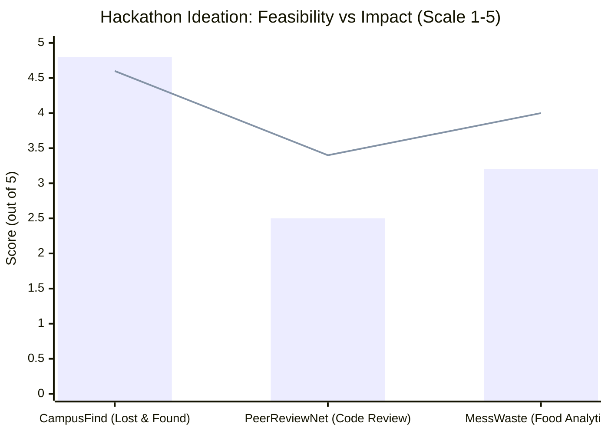

# Activity 14: Hackathon Preparation & Problem Scoping

**Course:** Portfolio Building for Engineering Students (`B25CS0311`)  
**Institution:** REVA University, School of Computer Science & Engineering  
**Lead Author:** Abaan Sufiyan ([@AbaanSufiyan01](https://github.com/AbaanSufiyan01))  
**Academic Standing:** 3rd Semester, B.Tech Computer Science & Engineering  

---

## 1. Overview & Objective

Participating in hackathons is a premier accelerator for collegiate software engineers. However, successful hackathon teams win not during the 24-hour coding sprint itself, but through **rigorous pre-competition preparation**: assembling complementary skillsets, shortlisting the right tier of competition, rigorously filtering ideas for feasibility vs. impact, and scoping architecture before writing a single line of code.

This repository encapsulates the full deliverable suite for **Activity 14**, serving as the launchpad for the upcoming hackathon build phase.

---

## 2. Step 1: Team Roster & Complementary Roles

A balanced 4-person team—**Team Synapse**—was formed combining low-level systems logic, modern frontend UI, database engineering, and product storytelling:

| Member Name | Academic Role | Hackathon Specialty | Primary Responsibilities |
|---|---|---|---|
| **Abaan Sufiyan** | 3rd Sem B.Tech CSE (REVA) | **Team Lead & Backend Engineer** | REST API architecture, database schema design, authentication, and Git repository management. |
| **Mohammed Zaid** | 3rd Sem B.Tech CSE (REVA) | **Frontend / UI Engineer** | Component design (React / Tailwind CSS), state management, mobile-first responsive layout, and client-side validation. |
| **Aditi Sharma** | 3rd Sem B.Tech CSE (REVA) | **Cloud & Integration Specialist** | Database hosting, API route integration, image upload pipelines (Cloudinary/S3), and automated deployment. |
| **Rohan Kulkarni** | 3rd Sem B.Tech CSE (REVA) | **Product Design & Pitch Lead** | User journey mapping, Figma wireframing, slide deck preparation, and final jury presentation demo. |

---

## 3. Step 2: Shortlisted Hackathon Target

After evaluating active student listings on Devfolio and Unstop, the team shortlisted:

- **Target Hackathon:** **Hack Bengaluru 2026 (Student Edition)**
- **Platform Listing:** [Devfolio Hackathons Portal](https://devfolio.co/hackathons) / [Unstop Engineering Hackathons](https://unstop.com/hackathons)
- **Direct Portal Link:** `https://devfolio.co/discover`
- **Format:** 36-Hour In-Person / Hybrid Hackathon
- **Location:** Bengaluru Tech Hub, Karnataka
- **Eligible Track:** Smart Campus & Sustainable Urban Living
- **Team Size Limit:** 2–4 members (Team Synapse fully compliant with 4 members)
- **Key Constraints:** Must demo a functional deployed prototype with live database queries; judging heavily weights working software over pitch-only concepts.

---

## 4. Step 3: Ideation & Feasibility vs. Impact Matrix

The team brainstormed 3 authentic, campus-centric challenges and evaluated each on a 1–5 scale across **Technical Feasibility** (ability to ship in 36 hours) and **Real-World Impact**:



| Idea # | Concept Name | Problem Statement | Feasibility (1–5) | Impact (1–5) | Verdict |
|:---:|---|---|:---:|:---:|:---:|
| **1** | **CampusFind** *(Selected)* | **Smart Lost-and-Found Web Platform for Campuses:** Solves lost ID cards, chargers, and valuables via block-indexed tagging and verified claim workflows. | **4.8 / 5** | **4.6 / 5** | **WINNER:** High daily relevance for 15,000+ REVA students; clean CRUD scope with achievable 36-hr prototype. |
| **2** | **PeerReviewNet** | **Local P2P Lab Code Review Network:** Automated peer code reviews for academic lab assignments. | **2.5 / 5** | **3.4 / 5** | *Rejected:* High complexity in parsing multiple compilers, security sandboxing, and plagiarism checking. |
| **3** | **MessWaste Tracker** | **Hostel Cafeteria Waste Analytics:** IoT scales and computer-vision food waste prediction for hostel messes. | **3.2 / 5** | **4.0 / 5** | *Rejected:* Hardware dependencies and lack of access to cafeteria scales during hackathon sprint. |

---

## 5. Step 4: Scoped Problem Statement & Technical Stack

### The Problem Statement (Final Scoped Copy)
> "Undergraduate students across large university campuses frequently lose essential personal items—including identity cards, laptop chargers, scientific calculators, and room keys—with zero centralized mechanisms to log, search, or reclaim them. Today, recovery relies on fragmented WhatsApp broadcast groups where urgent notices are rapidly buried under chatter and personal phone numbers are exposed to public spam. **CampusFind** is a secure, location-indexed lost-and-found web portal where discoverers can log items categorized by campus block and date, while rightful owners can search existing listings and initiate secure verification claims through automated security questions, completely eliminating chaotic social media spam and restoring lost student belongings within hours."

### Proposed Architecture & Tech Stack:

```text
┌────────────────────────────────────────────────────────┐
│  Client (Mobile/Desktop Web)                           │
│  React 18 + Vite • Tailwind CSS • Lucide Icons         │
└───────────────────────────┬────────────────────────────┘
                            │ HTTPS / REST API
┌───────────────────────────▼────────────────────────────┐
│  Application Server                                    │
│  Node.js (Express.js) • JWT Authentication             │
└───────────────────────────┬────────────────────────────┘
                            │ SQL Queries
┌───────────────────────────▼────────────────────────────┐
│  Relational Database & Media Storage                   │
│  PostgreSQL (Supabase) • Cloudinary Image CDN          │
└────────────────────────────────────────────────────────┘
```

- **Frontend:** **React (Vite)** with **Tailwind CSS** — Selected for zero-configuration bundle speed, instant hot-reloading, and responsive pre-built component styling.
- **Backend API:** **Node.js with Express.js** — Lightweight REST architecture for rapid endpoint scaffolding (items, claims, users).
- **Database & Auth:** **PostgreSQL via Supabase** — Relational schema with index lookups on `location_block`, `category`, and `date_found`. Includes built-in Row-Level Security.
- **Media Storage:** **Cloudinary API** — Direct multipart image upload pipeline for item photo verification.
- **Deployment Platform:** **Vercel** (Frontend) + **Render** (Backend API), enabling instantaneous CI/CD on every Git push.

---

## 6. Deliverable & Evidence Checklist

| Requirement | Description | Status | Verification Detail |
|---|---|:---:|---|
| **Team Roster** | 2–4 members with distinct complementary roles | ✅ Complete | 4 members (Lead/Backend, Frontend, Cloud, Pitch) documented. |
| **Hackathon Shortlist** | Active verified listing from Devfolio or Unstop | ✅ Complete | Shortlisted from Devfolio Bengaluru tech cluster. |
| **Ideation Matrix** | 3 brainstormed ideas with Feasibility vs. Impact scores | ✅ Complete | Scored matrix selecting *CampusFind*. |
| **Scoped Problem Statement** | One-paragraph problem, user base, and solution | ✅ Complete | Formulated and reviewed for 15,000+ student campus scope. |
| **Tech Stack Definition** | Matched to existing strengths for 36-hr execution | ✅ Complete | React, Express, Supabase, Tailwind, Vercel stack outlined. |

---

## 7. Portfolio Navigation

- [Activity 13: Tech Ambassador Pathway](https://github.com/AbaanSufiyan01/Activity-13-Tech-Ambassador-Pathway)
- [Activity 12: Portfolio Blog](https://github.com/AbaanSufiyan01/Activity-12-Portfolio-Blog)
- [Activity 10: LinkedIn Networking](https://github.com/AbaanSufiyan01/Activity-10-LinkedIn-Networking)
- [Activity 08: HackerRank Algorithmic Portfolio](https://github.com/AbaanSufiyan01/HackerRank-3rdSem-Portfolio)
